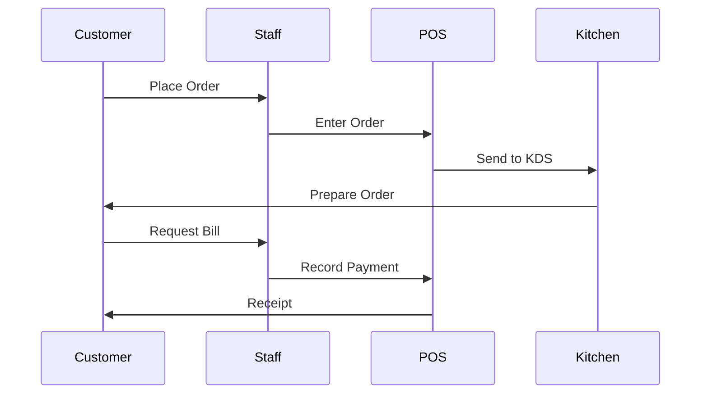

# Getting started

This is the path from a new account to a working restaurant: create the account, verify the email, choose a plan, open the POS, and take the first order.

## The order of the steps

1. [Create your account](../overview) — the signup form on the site
2. [Verify your email](quickstart) — the link in the verification email
3. [Choose a plan](../customer-portal) — the subscription wizard in the portal
4. [Set up your outlet](setup-outlet) — the branch settings in the POS
5. [Take your first order](../../pos-app/taking-orders) — the counter screen

## What the system does

## The order flow

| Status | Description |
|--------|-------------|
| Pending | Order received, awaiting confirmation |
| Confirmed | Order confirmed by staff |
| Preparing | Kitchen is preparing the order |
| Ready | Order ready for serving |
| Served | Food delivered to customer |
| Paid | Payment completed |

## The three apps you will use

| App | URL | What it is for |
|-----|-----|----------------|
| **Site** | `site.ideazes.com` | Signing up, choosing a plan, paying invoices, changing your password |
| **POS app** | `app.ideazes.com` | The screen your staff work from during service |
| **Customer app** | `order.ideazes.com` | Where your guests order |

## Need help?

- [View FAQs](../../troubleshooting/faqs)
- [Contact support](mailto:support@ideazes.com)
